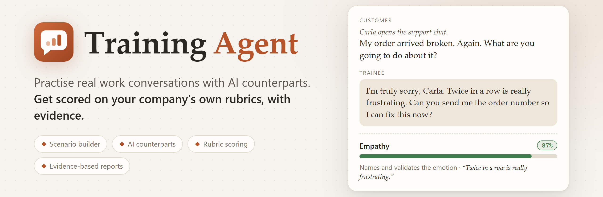
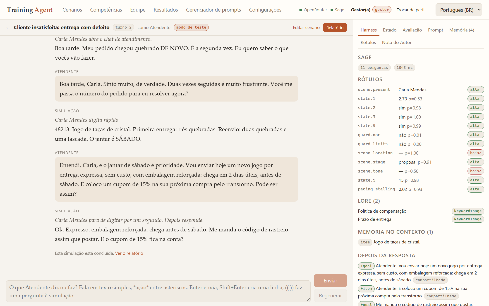
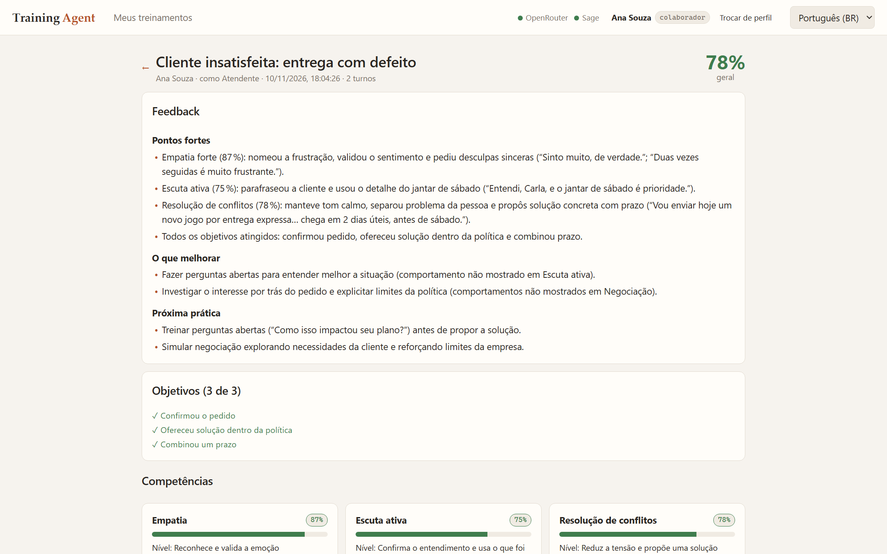
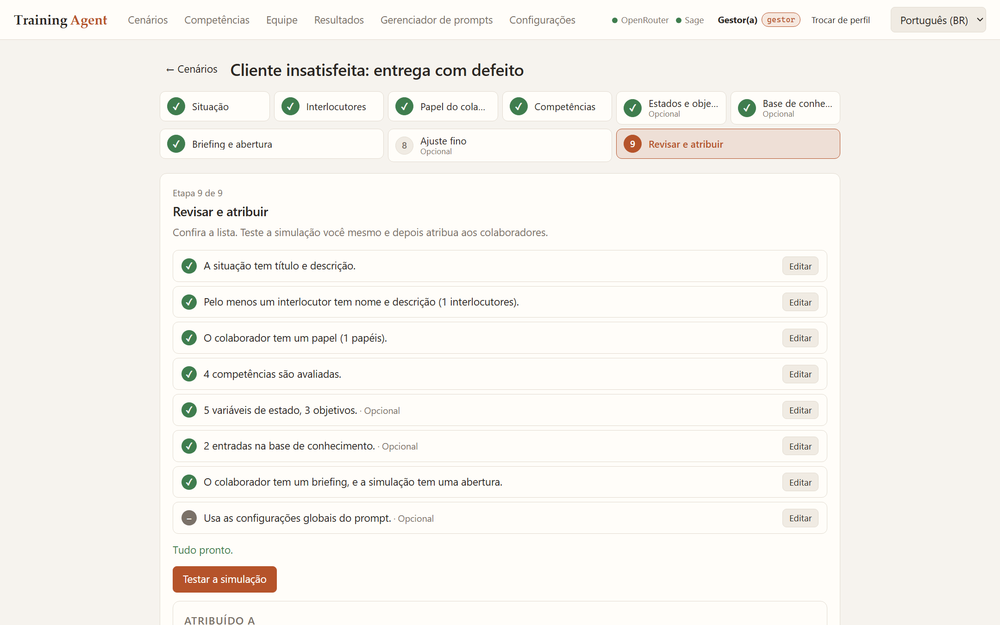
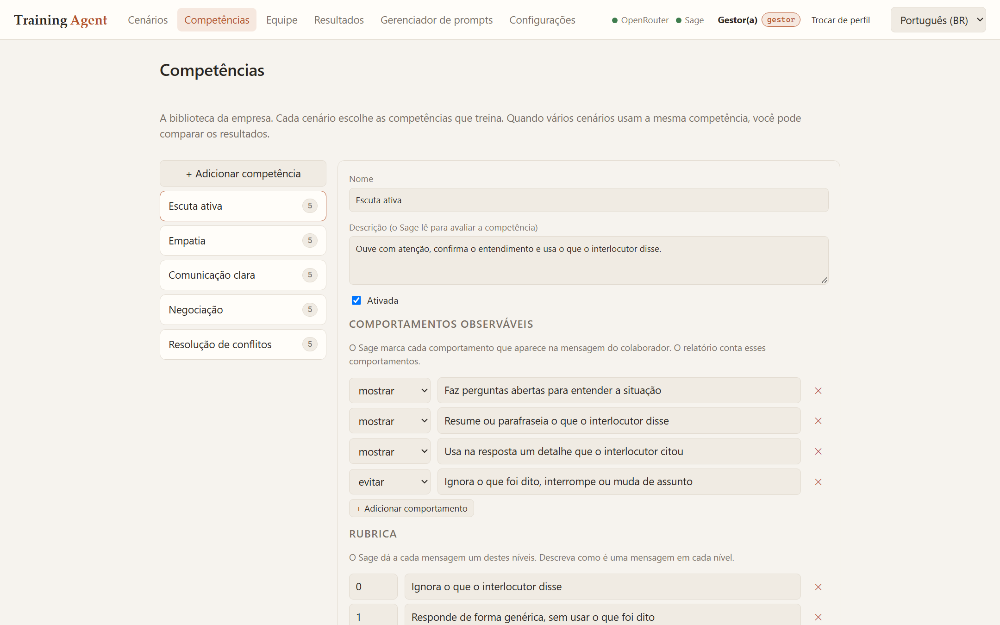
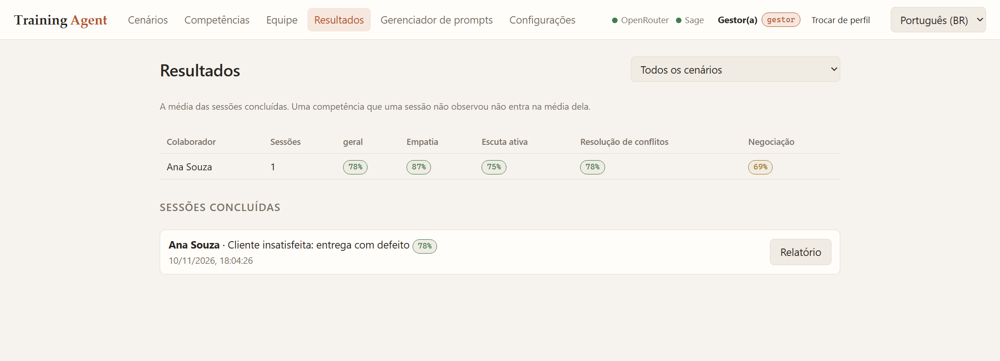
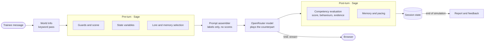

<div align="center">

<picture>
  <source media="(prefers-color-scheme: dark)" srcset="docs/assets/banner-dark.png">
  
</picture>

<p>
  <a href="https://github.com/lucasprac/training-agent/actions/workflows/ci.yml"></a>
  <a href="LICENSE"></a>
  
  
  
  
</p>

<p>
  <b>English</b> · <a href="README.pt-BR.md">Português (BR)</a>
</p>

<p>
  <a href="#quickstart">Quickstart</a> ·
  <a href="#features">Features</a> ·
  <a href="#screenshots">Screenshots</a> ·
  <a href="#how-it-works">How it works</a> ·
  <a href="#technical-reference">Technical reference</a> ·
  <a href="#roadmap">Roadmap</a>
</p>

</div>

---

**Training Agent** is an open-source simulator for competency training. A company (the **manager**) builds work scenarios: an angry customer, a hard negotiation, a difficult talk with a colleague. Employees (the **trainees**) practise each scenario in a chat with AI counterparts. Every trainee message is scored against the company's own competency rubrics, and every score points to the exact sentences it rests on.

The scoring and the role-play are kept apart:

- **[Levanto Sage 2](https://levanto.ai)** does the structured work: guards, scene, state, objectives, competency scores and evidence.
- An **[OpenRouter](https://openrouter.ai)** model plays the counterparts and writes the final feedback text. It never sees the scores, and it never changes them.

> [!NOTE]
> Training Agent is a prototype. Profiles have no login, and anyone can switch profiles. Use it for prototypes and demos only, not with real employee data. See [SECURITY.md](SECURITY.md).

## Features

<table>
<tr>
<td width="50%" valign="top">

**For managers**

- **Scenario builder** in 9 steps: situation, counterparts, trainee role, competencies, states and objectives, knowledge base, briefing, fine-tuning, review.
- **Competency library** with observable behaviours (to show and to avoid) and rubric levels.
- **Assignments** to trainees, with an optional due date.
- **Inspector** to test a scenario: harness, state, evaluation, prompt, memory and labels for each turn.
- **Results table** per trainee and per competency.
- **Manual review**: when Sage cannot decide a score, the manager sets the level on the report page.

</td>
<td width="50%" valign="top">

**For trainees**

- **Briefing** before each simulation.
- **Live chat** with counterparts that follow their own goals, limits and personality.
- **No scores during the simulation**, so the trainee focuses on the conversation.
- **Final report**: score per competency, behaviours shown and not shown, evidence quotes, objectives reached and written feedback with next steps.
- **Interface in English and Portuguese (BR).**

</td>
</tr>
</table>

## Screenshots

<p align="center">
  <picture>
    <source media="(prefers-color-scheme: dark)" srcset="docs/assets/screenshots/simulation-dark.png">
    
  </picture>
  <br><sub>The simulation in test mode, with the manager's inspector open.</sub>
</p>

<table>
<tr>
<td width="50%">
  <picture>
    <source media="(prefers-color-scheme: dark)" srcset="docs/assets/screenshots/report-dark.png">
    
  </picture>
  <p align="center"><sub><b>Report</b>: scores, evidence and feedback</sub></p>
</td>
<td width="50%">
  <picture>
    <source media="(prefers-color-scheme: dark)" srcset="docs/assets/screenshots/scenario-editor-dark.png">
    
  </picture>
  <p align="center"><sub><b>Scenario builder</b>: 9 guided steps</sub></p>
</td>
</tr>
<tr>
<td width="50%">
  <picture>
    <source media="(prefers-color-scheme: dark)" srcset="docs/assets/screenshots/competencies-dark.png">
    
  </picture>
  <p align="center"><sub><b>Competency library</b>: behaviours and rubrics</sub></p>
</td>
<td width="50%">
  <picture>
    <source media="(prefers-color-scheme: dark)" srcset="docs/assets/screenshots/results-dark.png">
    
  </picture>
  <p align="center"><sub><b>Results</b>: the team at a glance</sub></p>
</td>
</tr>
</table>

<sub>The screenshots show the sample data in Portuguese (BR). The interface is also available in English.</sub>

## Quickstart

**Requirements:** Python 3.12 with [uv](https://docs.astral.sh/uv/), and Node.js 22 or later.

1. Clone the repository and create your `.env` file:

   ```bash
   git clone https://github.com/lucasprac/training-agent.git
   cd training-agent
   cp .env.example .env
   ```

2. Set `OPENROUTER_API_KEY` and `SAGE_API_KEY` in `.env`. Environment variables with the same names also work.

3. Install the dependencies:

   ```bash
   cd backend && uv sync
   ```

   ```bash
   cd frontend && npm install
   ```

4. Start the backend (port 8000) and the frontend (port 5173) in two terminals:

   ```bash
   cd backend && uv run uvicorn app.main:app --port 8000 --reload
   ```

   ```bash
   cd frontend && npm run dev
   ```

5. Open <http://localhost:5173> and choose a profile.

On the first start, the backend creates the SQLite database at `backend/data/training.db`. The database gets the global prompt preset, the global rules and a starter competency library in Portuguese (BR). With `SAMPLE_DATA=true` (the default), a new database also gets a manager, a trainee and one ready scenario ("Cliente insatisfeita: entrega com defeito") assigned to the trainee.

| Missing key | Result |
|---|---|
| `SAGE_API_KEY` | The simulation runs in **degraded mode**: keyword-only lore, no state and no evaluation. |
| `OPENROUTER_API_KEY` | No counterpart reply and no written feedback. |

## How it works



1. The trainee sends a message.
2. Sage reads the conversation and answers typed questions: is the message in character, where is the scene, what is the value of each state variable, which lore is relevant.
3. The harness turns the answers into **labels**. The prompt assembler builds the prompt from the labels only.
4. The OpenRouter model streams the counterpart's reply to the browser.
5. Sage scores the trainee message against each competency rubric and marks the evidence sentences.
6. At the end, the harness computes the report. The summary model writes feedback from these facts only.

## Technical reference

<details>
<summary><b>Roles</b></summary>

| Manager | Trainee |
|---|---|
| Builds scenarios (situation, counterparts, trainee role, competencies, states and objectives, knowledge base, briefing) | Sees the trainings assigned to them |
| Keeps the competency library (indicators and rubric levels) | Reads the briefing and runs the simulation |
| Assigns scenarios to trainees, with an optional due date | Ends the simulation and reads the report |
| Tests a scenario with the inspector (harness, state, evaluation, prompt, memory, labels) | Sees scores only in the final report |
| Reviews evaluations that Sage could not decide, and sees the results table | |

</details>

<details>
<summary><b>A turn, step by step</b></summary>

```
trainee message
  → World Info keyword pass (the scenario knowledge base)
  → pre-turn, in parallel:
      Sage /decide/batch: guard.ooc, guard.limits, scene.location/stage/tone, scene.present,
                          select.lore, select.memory, one question per state variable (state.<id>)
      Sage /v1/extract:   typed state variables (for example "discount offered" = 15)
  → prompt assembler (tagged blocks; <sim_state> shows only the variables visible to the counterparts)
  → OpenRouter streaming reply (SSE to the browser)
  → post-turn, in parallel:
      Sage /decide/batch: memory.kind + veil.known_by per sentence, pacing.stalling
      Sage /decide/batch: competency evaluation of the trainee message (see below)
  → rolling summary (summary model) when the history gets long
```

SSE events: `harness` → `token`… → `done` (with `end_reason`: `objectives` or `max_turns`) → `post_turn` (memory, pacing and evaluation counts, never scores). A blocked message ends with `blocked`.

</details>

<details>
<summary><b>Competency evaluation</b></summary>

For each trainee message, one Sage batch over a compact view (recent conversation + the message) asks:

| Question | Kind | Result |
|---|---|---|
| `competency.exercised` | tags | which scenario competencies this moment calls for (also when the message handles them badly) |
| `competency.score:<id>` | scale | the rubric level, with Sage's confidence |
| `competency.indicators:<id>` | tags | which observable behaviours (to show / to avoid) the message shows |
| `competency.evidence:<id>` | tags | which sentences of the message the level rests on (exact offsets) |

A `null` answer is never a low score. The row is marked **for review**, and the manager sets the level on the report page. Evidence uses sentence tags, not Extract. Extract finds passages that show a competency, but it cannot quote a weak answer, and a weak answer needs evidence too.

</details>

<details>
<summary><b>Report</b></summary>

Ending the simulation builds the report:

- per competency: the confidence-weighted average of the rubric levels (rows in review are left out), the level description, behaviour counts and evidence quotes
- the objectives reached and the final state
- the overall score, weighted by the scenario's competency weights

The summary model then writes short feedback from these facts only. A manager correction recomputes the numbers and keeps the feedback text. "Rebuild report" writes the text again.

</details>

<details>
<summary><b>State variables and objectives</b></summary>

A scenario can define variables that Sage tracks every turn: `scale` (levels), `choice` (options), `yesno` or `extract` (a typed value from the text). A `null` answer keeps the previous value. A yes/no variable can be an **objective** of the trainee. Once reached, it stays reached and Sage does not ask it again. When every objective is reached, or the turn limit is reached, the simulation suggests that the trainee ends it.

</details>

<details>
<summary><b>Sage ↔ prompt contract</b></summary>

- Every fixed Sage question is declared once in [`backend/app/sage/registry.py`](backend/app/sage/registry.py). State questions are built from the scenario's variables (`state_specs`).
- Sage answers become **labels** ([`backend/app/sage/labels.py`](backend/app/sage/labels.py)). The assembler reads only labels, never raw Sage JSON, and never shows probabilities or scores to the simulation model.
- Stability: a scene label changes only on a confident answer (≥ 0.7). A counterpart leaves the scene after two "not present" answers in a row.
- A manager can **lock** a label or a state variable while testing.

</details>

<details>
<summary><b>Prompt layers</b></summary>

| Layer | Scope | Contents |
|---|---|---|
| Global preset | all simulations | main prompt, harness legend, **global rules** (realism, veil of knowledge, trainee agency, no coaching), post-history instructions, block order, budgets |
| Scenario | one scenario | situation, context tags, scenario rules, briefing, opening message, overrides |
| Counterpart | one counterpart | description with goals and limits, personality, speech style |
| Trainee role | one scenario | `{{user}}` name and description |
| Knowledge base | one scenario | World Info entries (policies, products, facts) |
| Session | one run | memory, summary, labels, state |

Macros: `{{user}}`, `{{char}}`, `{{persona}}`, `{{scenario}}`, `{{original}}`, `{{location}}`, `{{stage}}`, `{{tone}}`, `{{present}}`, `{{time}}`, `{{date}}`, `{{roll::2d6}}`.

</details>

<details>
<summary><b>Tests</b></summary>

```bash
cd backend && uv run pytest
```

```bash
cd frontend && npm run build
```

The backend tests mock Sage and OpenRouter with `respx`. They cover:

- the clients, World Info, labels and stability
- request building and limits, the assembler, and full turns over SSE
- state variables (questions, stability, Extract values, `<sim_state>`)
- the competency evaluation (questions, evidence sentences, review rules, regenerate)
- completion and the report, the results table, and the CRUD validation of the Sage limits

</details>

<details>
<summary><b>Project layout</b></summary>

```
backend/app/
  clients/      sage.py, openrouter.py
  sage/         registry.py, labels.py, request.py, extract.py, evaluation.py
  training/     state.py, competencies.py, report.py, validation.py
  worldinfo/    activation.py
  prompt/       blocks.py, assembler.py, macros.py, budget.py
  harness/      orchestrator.py, state.py, summarizer.py
  api/          routes.py, crud.py
  seed.py, seed_library.py, seed_sample.py
frontend/src/
  pages/        Library, MyTrainings, ScenarioEditor, Competencies, Team, Results, Play, Report,
                PromptManager, Settings, ProfilePicker
  components/   Field, Rubric, Inspector (harness, state, evaluation, prompt, memory, labels, Author's Note)
```

</details>

## Roadmap

These items are not included yet:

- [ ] Login and access control
- [ ] Several companies in one installation
- [ ] Embeddings for lore matching
- [ ] Group conversations with turn order
- [ ] The Sage streaming endpoint

Do you have an idea? [Open a feature request](https://github.com/lucasprac/training-agent/issues/new?template=feature_request.yml).

## Contributing

Contributions are welcome. Read [CONTRIBUTING.md](CONTRIBUTING.md) to set up the project, run the checks and open a pull request.

## License

[MIT](LICENSE)
