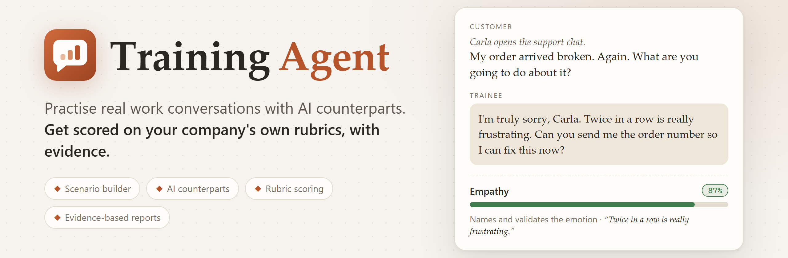
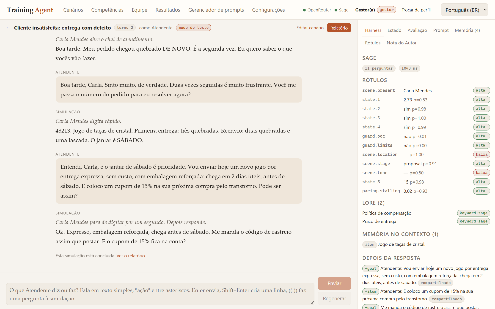
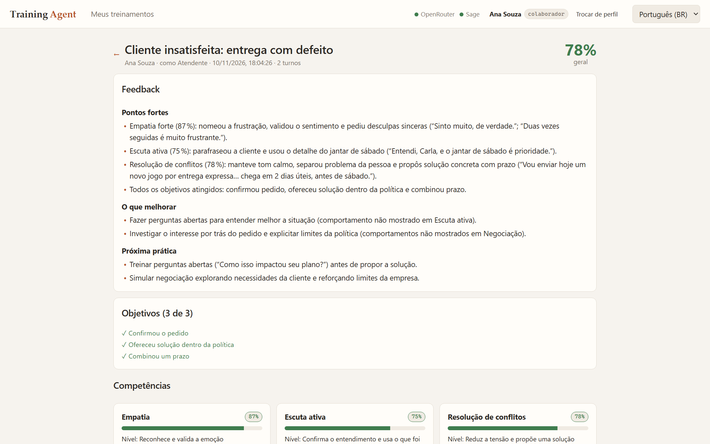
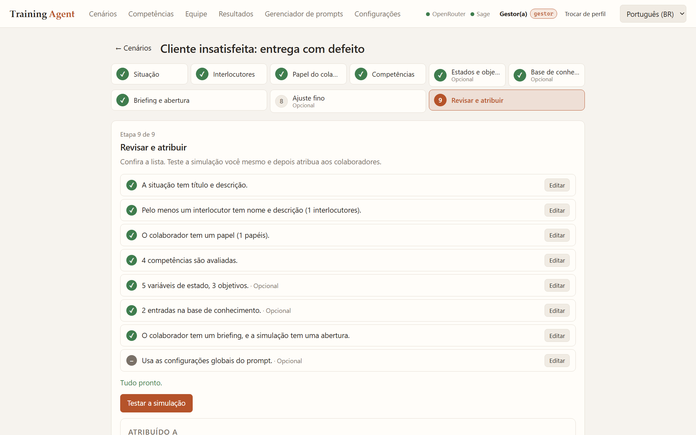
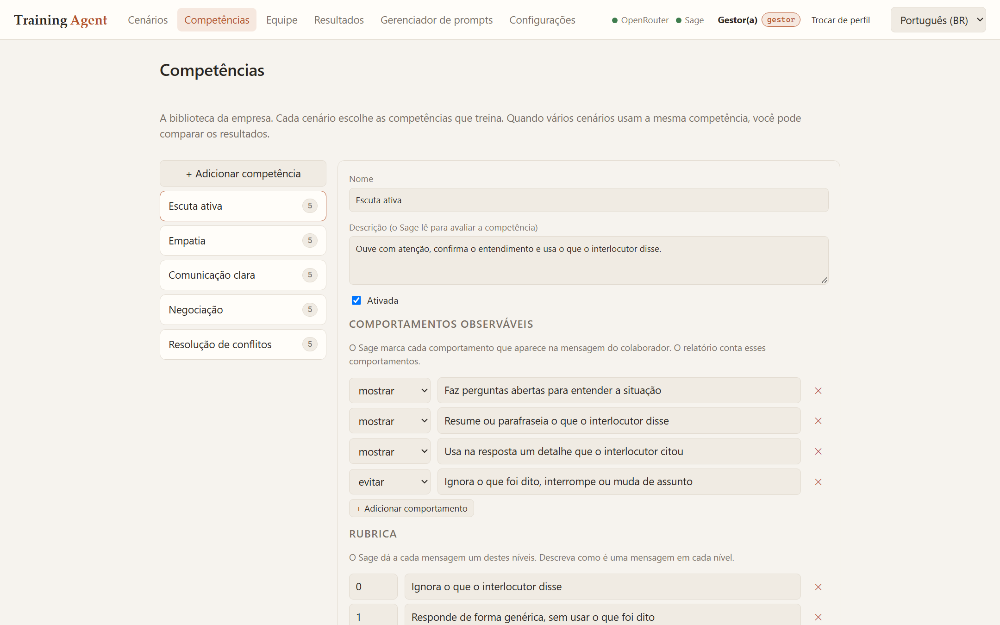
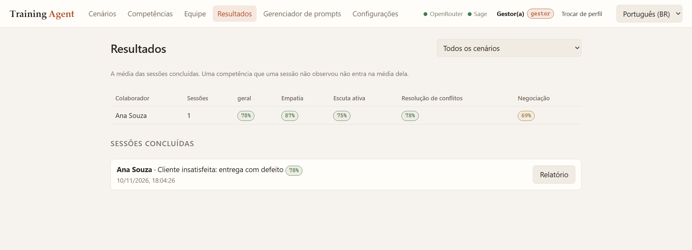
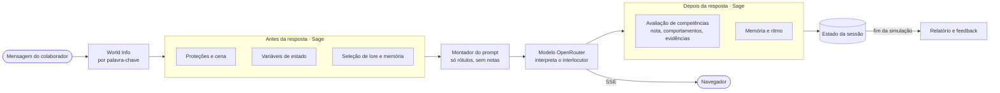

<div align="center">

<picture>
  <source media="(prefers-color-scheme: dark)" srcset="docs/assets/banner-dark.png">
  
</picture>

<p>
  <a href="https://github.com/lucasprac/training-agent/actions/workflows/ci.yml"></a>
  <a href="LICENSE"></a>
  
  
  
  
</p>

<p>
  <a href="README.md">English</a> · <b>Português (BR)</b>
</p>

<p>
  <a href="#início-rápido">Início rápido</a> ·
  <a href="#recursos">Recursos</a> ·
  <a href="#telas">Telas</a> ·
  <a href="#como-funciona">Como funciona</a> ·
  <a href="#referência-técnica">Referência técnica</a> ·
  <a href="#próximos-passos">Próximos passos</a>
</p>

</div>

---

**Training Agent** é um simulador de código aberto para treinar competências. A empresa (o **gestor**) cria cenários de trabalho: uma cliente irritada, uma negociação difícil, uma conversa delicada com um colega. Os colaboradores praticam cada cenário em um chat com interlocutores de IA. Cada mensagem do colaborador recebe uma nota pelas rubricas de competência da própria empresa, e cada nota aponta as frases exatas em que se baseia.

A avaliação e a encenação ficam separadas:

- O **[Levanto Sage 2](https://levanto.ai)** faz o trabalho estruturado: proteções, cena, estado, objetivos, notas de competência e evidências.
- Um modelo do **[OpenRouter](https://openrouter.ai)** interpreta os interlocutores e escreve o feedback final. Ele nunca vê as notas e nunca as altera.

> [!NOTE]
> O Training Agent é um protótipo. Os perfis não têm login, e qualquer pessoa pode trocar de perfil. Use só em protótipos e demonstrações, não com dados reais de colaboradores. Veja [SECURITY.md](SECURITY.md).

## Recursos

<table>
<tr>
<td width="50%" valign="top">

**Para gestores**

- **Editor de cenários** em 9 etapas: situação, interlocutores, papel do colaborador, competências, estados e objetivos, base de conhecimento, briefing, ajuste fino e revisão.
- **Biblioteca de competências** com comportamentos observáveis (a mostrar e a evitar) e níveis de rubrica.
- **Atribuição** de cenários aos colaboradores, com prazo opcional.
- **Inspetor** para testar um cenário: harness, estado, avaliação, prompt, memória e rótulos de cada turno.
- **Tabela de resultados** por colaborador e por competência.
- **Revisão manual**: quando o Sage não consegue decidir uma nota, o gestor define o nível na página do relatório.

</td>
<td width="50%" valign="top">

**Para colaboradores**

- **Briefing** antes de cada simulação.
- **Chat ao vivo** com interlocutores que seguem objetivos, limites e personalidade próprios.
- **Sem notas durante a simulação**, para o colaborador se concentrar na conversa.
- **Relatório final**: nota por competência, comportamentos mostrados e não mostrados, trechos de evidência, objetivos atingidos e feedback escrito com próximos passos.
- **Interface em português (BR) e inglês.**

</td>
</tr>
</table>

## Telas

<p align="center">
  <picture>
    <source media="(prefers-color-scheme: dark)" srcset="docs/assets/screenshots/simulation-dark.png">
    
  </picture>
  <br><sub>A simulação em modo de teste, com o inspetor do gestor aberto.</sub>
</p>

<table>
<tr>
<td width="50%">
  <picture>
    <source media="(prefers-color-scheme: dark)" srcset="docs/assets/screenshots/report-dark.png">
    
  </picture>
  <p align="center"><sub><b>Relatório</b>: notas, evidências e feedback</sub></p>
</td>
<td width="50%">
  <picture>
    <source media="(prefers-color-scheme: dark)" srcset="docs/assets/screenshots/scenario-editor-dark.png">
    
  </picture>
  <p align="center"><sub><b>Editor de cenários</b>: 9 etapas guiadas</sub></p>
</td>
</tr>
<tr>
<td width="50%">
  <picture>
    <source media="(prefers-color-scheme: dark)" srcset="docs/assets/screenshots/competencies-dark.png">
    
  </picture>
  <p align="center"><sub><b>Biblioteca de competências</b>: comportamentos e rubricas</sub></p>
</td>
<td width="50%">
  <picture>
    <source media="(prefers-color-scheme: dark)" srcset="docs/assets/screenshots/results-dark.png">
    
  </picture>
  <p align="center"><sub><b>Resultados</b>: a equipe em uma tela</sub></p>
</td>
</tr>
</table>

## Início rápido

**Requisitos:** Python 3.12 com [uv](https://docs.astral.sh/uv/) e Node.js 22 ou mais recente.

1. Clone o repositório e crie o arquivo `.env`:

   ```bash
   git clone https://github.com/lucasprac/training-agent.git
   cd training-agent
   cp .env.example .env
   ```

2. Preencha `OPENROUTER_API_KEY` e `SAGE_API_KEY` no `.env`. Variáveis de ambiente com os mesmos nomes também funcionam.

3. Instale as dependências:

   ```bash
   cd backend && uv sync
   ```

   ```bash
   cd frontend && npm install
   ```

4. Inicie o backend (porta 8000) e o frontend (porta 5173) em dois terminais:

   ```bash
   cd backend && uv run uvicorn app.main:app --port 8000 --reload
   ```

   ```bash
   cd frontend && npm run dev
   ```

5. Abra <http://localhost:5173> e escolha um perfil.

Na primeira execução, o backend cria o banco SQLite em `backend/data/training.db`. O banco recebe o preset global de prompt, as regras globais e uma biblioteca inicial de competências em português. Com `SAMPLE_DATA=true` (o padrão), um banco novo também recebe um gestor, uma colaboradora e um cenário pronto ("Cliente insatisfeita: entrega com defeito") atribuído a ela.

| Chave ausente | Resultado |
|---|---|
| `SAGE_API_KEY` | A simulação roda em **modo reduzido**: base de conhecimento só por palavra-chave, sem estado e sem avaliação. |
| `OPENROUTER_API_KEY` | Sem resposta dos interlocutores e sem feedback escrito. |

## Como funciona



1. O colaborador envia uma mensagem.
2. O Sage lê a conversa e responde perguntas tipadas: a mensagem está dentro do papel? Onde está a cena? Qual é o valor de cada variável de estado? Que conhecimento é relevante?
3. O harness transforma as respostas em **rótulos**. O montador do prompt usa só os rótulos.
4. O modelo do OpenRouter transmite a resposta do interlocutor ao navegador.
5. O Sage avalia a mensagem do colaborador por cada rubrica e marca as frases de evidência.
6. No fim, o harness calcula o relatório. O modelo de resumo escreve o feedback só a partir desses fatos.

## Referência técnica

<details>
<summary><b>Papéis</b></summary>

| Gestor | Colaborador |
|---|---|
| Cria cenários (situação, interlocutores, papel do colaborador, competências, estados e objetivos, base de conhecimento, briefing) | Vê os treinamentos atribuídos a ele |
| Mantém a biblioteca de competências (indicadores e níveis de rubrica) | Lê o briefing e faz a simulação |
| Atribui cenários aos colaboradores, com prazo opcional | Encerra a simulação e lê o relatório |
| Testa um cenário com o inspetor (harness, estado, avaliação, prompt, memória, rótulos) | Vê as notas só no relatório final |
| Revisa as avaliações que o Sage não decidiu e vê a tabela de resultados | |

</details>

<details>
<summary><b>Um turno, passo a passo</b></summary>

```
mensagem do colaborador
  → World Info por palavra-chave (a base de conhecimento do cenário)
  → antes da resposta, em paralelo:
      Sage /decide/batch: guard.ooc, guard.limits, scene.location/stage/tone, scene.present,
                          select.lore, select.memory, uma pergunta por variável de estado (state.<id>)
      Sage /v1/extract:   variáveis de estado tipadas (por exemplo "desconto oferecido" = 15)
  → montador do prompt (blocos com tags; <sim_state> mostra só as variáveis visíveis aos interlocutores)
  → resposta do OpenRouter em streaming (SSE para o navegador)
  → depois da resposta, em paralelo:
      Sage /decide/batch: memory.kind + veil.known_by por frase, pacing.stalling
      Sage /decide/batch: avaliação de competências da mensagem do colaborador
  → resumo contínuo (modelo de resumo) quando o histórico fica longo
```

Eventos SSE: `harness` → `token`… → `done` (com `end_reason`: `objectives` ou `max_turns`) → `post_turn` (contagens de memória, ritmo e avaliação, nunca notas). Uma mensagem bloqueada termina com `blocked`.

</details>

<details>
<summary><b>Avaliação de competências</b></summary>

Para cada mensagem do colaborador, um lote do Sage sobre uma visão compacta (conversa recente + a mensagem) pergunta:

| Pergunta | Tipo | Resultado |
|---|---|---|
| `competency.exercised` | tags | quais competências do cenário este momento exige (também quando a mensagem as trata mal) |
| `competency.score:<id>` | escala | o nível da rubrica, com a confiança do Sage |
| `competency.indicators:<id>` | tags | quais comportamentos observáveis (a mostrar / a evitar) a mensagem mostra |
| `competency.evidence:<id>` | tags | em quais frases da mensagem o nível se baseia (posições exatas) |

Uma resposta `null` nunca vira nota baixa. A linha fica **em revisão**, e o gestor define o nível na página do relatório. As evidências usam tags de frase, não o Extract. O Extract encontra trechos que mostram uma competência, mas não consegue citar uma resposta fraca, e uma resposta fraca também precisa de evidência.

</details>

<details>
<summary><b>Relatório</b></summary>

Ao encerrar a simulação, o sistema monta o relatório:

- por competência: a média dos níveis da rubrica ponderada pela confiança (linhas em revisão ficam de fora), a descrição do nível, a contagem de comportamentos e os trechos de evidência
- os objetivos atingidos e o estado final
- a nota geral, ponderada pelos pesos das competências no cenário

Depois, o modelo de resumo escreve um feedback curto só com esses fatos. Uma correção do gestor recalcula os números e mantém o texto. "Refazer relatório" escreve o texto de novo.

</details>

<details>
<summary><b>Variáveis de estado e objetivos</b></summary>

Um cenário pode definir variáveis que o Sage acompanha a cada turno: `scale` (níveis), `choice` (opções), `yesno` ou `extract` (um valor tipado tirado do texto). Uma resposta `null` mantém o valor anterior. Uma variável sim/não pode ser um **objetivo** do colaborador. Depois de atingido, o objetivo continua atingido, e o Sage não pergunta de novo. Quando todos os objetivos são atingidos, ou o limite de turnos chega, a simulação sugere que o colaborador a encerre.

</details>

<details>
<summary><b>Contrato entre o Sage e o prompt</b></summary>

- Cada pergunta fixa do Sage é declarada uma vez em [`backend/app/sage/registry.py`](backend/app/sage/registry.py). As perguntas de estado vêm das variáveis do cenário (`state_specs`).
- As respostas do Sage viram **rótulos** ([`backend/app/sage/labels.py`](backend/app/sage/labels.py)). O montador lê só os rótulos, nunca o JSON bruto do Sage, e nunca mostra probabilidades ou notas ao modelo da simulação.
- Estabilidade: um rótulo de cena só muda com uma resposta confiante (≥ 0,7). Um interlocutor sai da cena depois de duas respostas "não presente" seguidas.
- O gestor pode **travar** um rótulo ou uma variável de estado durante os testes.

</details>

<details>
<summary><b>Camadas do prompt</b></summary>

| Camada | Alcance | Conteúdo |
|---|---|---|
| Preset global | todas as simulações | prompt principal, legenda do harness, **regras globais** (realismo, véu de conhecimento, autonomia do colaborador, sem orientação), instruções pós-histórico, ordem dos blocos, orçamentos |
| Cenário | um cenário | situação, tags de contexto, regras do cenário, briefing, mensagem de abertura, ajustes |
| Interlocutor | um interlocutor | descrição com objetivos e limites, personalidade, jeito de falar |
| Papel do colaborador | um cenário | nome e descrição de `{{user}}` |
| Base de conhecimento | um cenário | entradas de World Info (políticas, produtos, fatos) |
| Sessão | uma execução | memória, resumo, rótulos, estado |

Macros: `{{user}}`, `{{char}}`, `{{persona}}`, `{{scenario}}`, `{{original}}`, `{{location}}`, `{{stage}}`, `{{tone}}`, `{{present}}`, `{{time}}`, `{{date}}`, `{{roll::2d6}}`.

</details>

<details>
<summary><b>Testes</b></summary>

```bash
cd backend && uv run pytest
```

```bash
cd frontend && npm run build
```

Os testes do backend simulam o Sage e o OpenRouter com `respx`. Eles cobrem:

- os clientes, o World Info, os rótulos e a estabilidade
- a montagem das requisições e os limites, o montador e turnos completos por SSE
- as variáveis de estado (perguntas, estabilidade, valores do Extract, `<sim_state>`)
- a avaliação de competências (perguntas, frases de evidência, regras de revisão, regeneração)
- o encerramento e o relatório, a tabela de resultados e a validação dos limites do Sage no CRUD

</details>

<details>
<summary><b>Estrutura do projeto</b></summary>

```
backend/app/
  clients/      sage.py, openrouter.py
  sage/         registry.py, labels.py, request.py, extract.py, evaluation.py
  training/     state.py, competencies.py, report.py, validation.py
  worldinfo/    activation.py
  prompt/       blocks.py, assembler.py, macros.py, budget.py
  harness/      orchestrator.py, state.py, summarizer.py
  api/          routes.py, crud.py
  seed.py, seed_library.py, seed_sample.py
frontend/src/
  pages/        Library, MyTrainings, ScenarioEditor, Competencies, Team, Results, Play, Report,
                PromptManager, Settings, ProfilePicker
  components/   Field, Rubric, Inspector (harness, state, evaluation, prompt, memory, labels, Author's Note)
```

</details>

## Próximos passos

Estes itens ainda não existem:

- [ ] Login e controle de acesso
- [ ] Várias empresas na mesma instalação
- [ ] Embeddings para encontrar conhecimento relevante
- [ ] Conversas em grupo com ordem de turnos
- [ ] O endpoint de streaming do Sage

Tem uma ideia? [Abra uma sugestão](https://github.com/lucasprac/training-agent/issues/new?template=feature_request.yml).

## Como contribuir

Contribuições são bem-vindas. Leia o [CONTRIBUTING.md](CONTRIBUTING.md) para preparar o projeto, rodar as verificações e abrir um pull request.

## Licença

[MIT](LICENSE)
